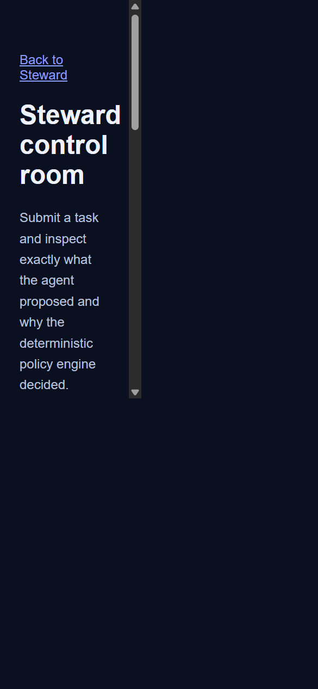
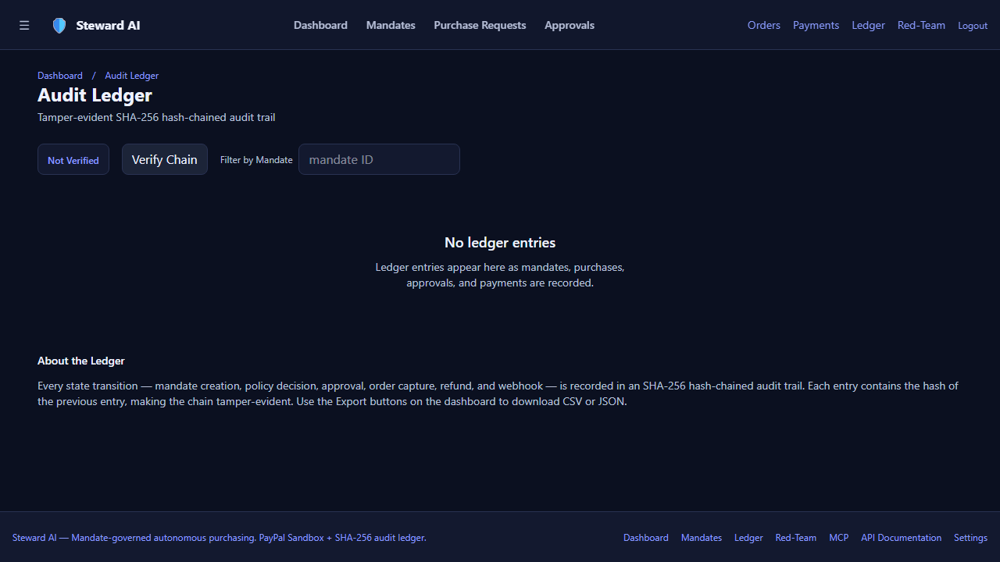

# Steward

## 30-second pitch

Steward lets an AI agent shop through PayPal Sandbox under an owner-defined
mandate. AI proposes and explains; deterministic policy rules decide; the server
alone can pay; and every transition is verifiable in a SHA-256 ledger.

**Try it live:** configure the deployed URL in the Devpost submission. The
dashboard's **Demo login** is the judge path. PayPal Sandbox buyer credentials
are intentionally placeholders and must be supplied by the release owner, not
committed here.

Steward is a safety-first PayPal Sandbox purchasing agent. A plain-English mandate
becomes an explicit budget and cap; fixture-backed Channel3 product data becomes a
cart; deterministic rules decide `AUTO_APPROVE`, `ASK_HUMAN`, or `BLOCK`; and every
transition is recorded in a tamper-evident PostgreSQL ledger.

> **Demo label:** PayPal Sandbox + Channel3 live/fixture catalog, simulated fulfilment.

## Documentation Index

- [UI & Workflow Guide](./docs/UI-GUIDE.md) — Comprehensive directory of every screen, button, route, and expected result
- [Architecture Specification](./docs/architecture.md) — System architecture, Mermaid sequence flows, security model, and API table
- [Threat Model (STRIDE)](./docs/threat-model.md) — Assets, threat actors, attack vectors, mitigations, and residual risks
- [Video Demo Script](./docs/video-script.md) — 2:50 timed judge demo walkthrough
- [Postman Collection](./docs/postman_collection.json) — Ready-to-import API tests
- [Claude Desktop MCP Config](./docs/claude_desktop_config.json) — External agent integration

## Five-minute quick start

Requirements: Node.js 20+, a PostgreSQL/Neon database, and PayPal Sandbox credentials.

```bash
git clone https://github.com/Princevish-dev/Steward.git
cd Steward
npm ci
copy .env.example .env.local
```

Set `DATABASE_URL`, `DATABASE_URL_UNPOOLED`, `PAYPAL_CLIENT_ID`,
`PAYPAL_CLIENT_SECRET`, `PAYPAL_ENVIRONMENT=SANDBOX`, and `APP_BASE_URL` in
`.env.local`, then run:

```bash
npm run db:migrate
npm run dev
```

Open `http://localhost:3000/dashboard`, click **Demo login — seed working data**,
and choose a scenario. `/new` creates an editable mandate. `/redteam` runs all
five hostile-data fixtures end to end.

## Architecture and safety model

1. Product text is untrusted and sanitized before policy evaluation.
2. All 13 rules evaluate; no rule short-circuits the safety decision.
3. Reviewer actions can escalate severity but never lower `BLOCK`.
4. PayPal routes accept only a persisted `runId`; amounts are computed from the
   persisted cart and decisions/approvals are checked server-side.
5. Orders are idempotent per run and the ledger is SHA-256 chained.
6. API keys are scoped to one mandate, stored only as SHA-256 hashes, and shown once.

## Screenshots





The visible banner states the current catalog and fulfilment mode:
**PayPal Sandbox - Channel3 live/fixture - fulfilment simulated**.

## PayPal API map

| Steward route | PayPal operation |
|---|---|
| `/api/paypal/orders` | Create Sandbox buyer-approved order (Orders API v2) |
| `/api/paypal/capture` | Capture the run-bound order (Orders API v2) |
| `/api/paypal/vault` | Returns 410; buyer approves each order; Vault requires merchant permissions |
| `/api/paypal/refund` | Refund the persisted capture (Payments API v2) |
| `/api/paypal/webhook` | Verify webhook signature (Notifications API) and record event |
| `/api/paypal/webhook/replay` | Development-only simulated dispute replay |
| `/api/disputes/advocate` | Generate evidence-only Dispute Advocate draft (Prompt A4) |

## AI and fixture map

No LLM output is trusted for money, limits, order IDs, or payment amounts.
Channel3 search is **real** when `CHANNEL3_API_KEY` and `CHANNEL3_API_URL` are set;
responses are cached for ten minutes and mapped/sanitized before policy. Without
the key, the UI labels the catalog as **fixture** fallback. Fulfilment and the
tracking number are simulated, although the tracking API call is real.

### Live AI Proof Metrics (Observed API Calls)

| Agent Role | Model | Latency | Tokens (In / Out) | Est. Cost (USD) | Fallback Guarantee |
|---|---|---|---|---|---|
| Mandate Parser | `gemini-3.5-flash-lite` | 1,770 ms | 130 / 292 | $0.000130 | Pure regex + keyword intent parser |
| Shopper Agent | `gemini-3.5-flash-lite` | 1,229 ms | 486 / 179 | $0.000120 | Deterministic item ranker + Channel3 fixtures |
| Risk Reviewer | `gemini-3.5-flash-lite` | 1,151 ms | 569 / 103 | $0.000098 | Escalate to `ASK_HUMAN` (fail-safe) |

All AI outputs strictly adhere to Zod validation schemas. When `USE_LLM=false` or
an API outage occurs, deterministic fallbacks activate immediately with zero
disruption to order validation. These three calls were verified on 2026-11-01
with the configured Gemini API credential; the checked-in metrics file records
their latency and estimated cost.

| Prompt | Model | Schema | Fallback |
|---|---|---|---|
| Natural-language mandate and owner | `gemini-3.5-flash-lite` | `mandateSchema` | Regex/keyword parser |
| Task plus sanitized catalog | `gemini-3.5-flash-lite` | `shopperSchema` | Deterministic ranker and fixtures |
| Mandate, cart, rules, and flags | `gemini-3.5-flash-lite` | `reviewerSchema` | Escalate to `ASK_HUMAN` |

## MCP, OpenAPI 3.1, and SDK

- `POST /api/mcp` is an MCP Streamable HTTP endpoint.
- Exactly four tools are exposed: `propose_purchase`, `get_mandate_status`,
  `list_my_purchases`, and `request_approval_status`.
- `POST /api/mcp/keys` creates a one-time mandate-scoped key.
- `openapi.yaml` is the full OpenAPI 3.1.0 contract; `/api/openapi` serves the JSON form.
- `GET /api/ledger/export` provides downloadable audit ledger exports in CSV and JSON formats.
- `src/sdk/steward.ts` is the typed HTTP client.
- Claude Desktop example: `docs/claude_desktop_config.json`.
- Postman collection: `docs/postman_collection.json` (22 requests covering all 7 major workflow categories).

## Deployment

`render.yaml` declares the web service and a ten-minute keep-warm cron. Configure
the secret environment variables in Render and run the database migration against
the direct database URL. Render deployment requires a connected Render account;
no credentials or production URL are stored in this repository.

The Render blueprint uses the existing Neon `DATABASE_URL` and
`DATABASE_URL_UNPOOLED` secrets; it does not provision a Render Postgres database.
Required environment variables are `DATABASE_URL`, `DATABASE_URL_UNPOOLED`,
`DATABASE_SSL`, `PAYPAL_ENVIRONMENT`, `PAYPAL_CLIENT_ID`, `PAYPAL_CLIENT_SECRET`,
`PAYPAL_WEBHOOK_ID`, `CHANNEL3_API_KEY`, `CHANNEL3_API_URL`, `VAULT_ENC_KEY`, `SESSION_SECRET`,
`ANTHROPIC_API_KEY`, `ANTHROPIC_MODEL`, `GOOGLE_GENERATIVE_AI_API_KEY`, `GEMINI_MODEL`, `USE_LLM`, and `APP_BASE_URL`.
`GET /api/health` is the keep-warm target.

## Limitations & Truth in Advertising

1. **PayPal Sandbox Only:** Tested with Sandbox accounts; live production credentials are not supported.
2. **Simulated Fulfilment:** Physical shipment tracking entries use a simulated carrier (`SIMULATED_CARRIER`), though tracking calls hit the real PayPal Sandbox Orders v2 tracking API.
3. **Channel3 Fallback:** When `CHANNEL3_API_KEY` is not provided, high-quality sanitized fixtures represent product inventory.
4. **Vault Permission Decision:** The PayPal Sandbox application returns `403 NOT_AUTHORIZED` on `/v3/vault/setup-tokens`. Accordingly, approve-once Vault payments are not claimed or supported in this build; the buyer explicitly approves each order in PayPal Sandbox.

## Sponsor and tooling map

Channel3 supplies catalog search, AG Grid supplies the ledger UI, Render supplies
deployment configuration, APIMatic informed API contract validation, and Postman
supplies the API collection. AI SDK providers are used only for structured
proposals, review, and evidence drafting.

## License

MIT License - see [LICENSE](./LICENSE)
