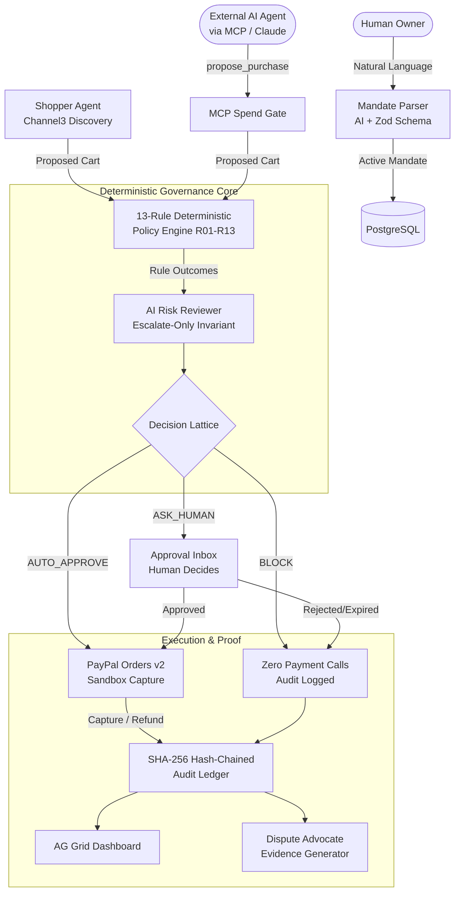

# Steward AI — Project Handoff & Persistent Memory

**Repository:** https://github.com/Princevish-dev/Steward  
**Primary Feature Branch:** `fix/frontend-visual-regression`  
**Current HEAD Commit:** `75766a8`  
**Last Updated:** 2026-11-02  
**Hackathon Target:** PayPal AI Hackathon 2026 (Devpost)  
**License:** MIT License (Open Source)

---

## 1. Product Overview & Core Philosophy

**Tagline:**  
> *"Give your AI agent a mandate, not your credit card."*

**Positioning:**  
> *"The financial governance infrastructure for autonomous AI commerce."*

**Core Product Mantra:**  
> **AI proposes. Policy decides. Humans control. PayPal executes. Ledger proves.**

### What Steward AI Does
Steward AI is an autonomous purchasing governance platform that acts as a secure firewall between probabilistic AI agents and real financial accounts. Instead of handing an LLM payment credentials or requiring tedious manual confirmation for every single click:
1. **Natural-Language Mandates:** A human owner defines purchasing boundaries in plain English (e.g., *"Reorder office supplies and coffee for my studio; max $120 a month; nothing over $40 per item; ask me above $60"*).
2. **Deterministic Governance:** Steward parses this into a typed, Zod-validated Mandate. A pure, deterministic 13-rule policy engine (R01–R13) evaluates every proposed cart.
3. **Escalate-Only AI Review:** An AI Risk Reviewer inspects product context, anomalous pricing, and prompt injection signals. The LLM can only escalate caution (`AUTO_APPROVE` → `ASK_HUMAN` → `BLOCK`), never relax or override deterministic rules.
4. **PayPal Sandbox Settlement:** Permitted or human-approved purchases are securely settled via the PayPal Orders API v2 in Sandbox with cryptographic idempotency (`PayPal-Request-Id: sha256(runId + cartHash)`).
5. **SHA-256 Audit Ledger:** Every state transition (mandate creation, evaluation, approval, capture, tracking, refund, webhook, dispute evidence) is appended to an immutable, hash-chained ledger backed by PostgreSQL advisory transaction locks.
6. **Agent-Agnostic MCP Spend Gate:** External AI agents (Claude Desktop, Cursor, Cline) connect via the Model Context Protocol (Streamable HTTP) to propose purchases under mandate-scoped API keys without direct card access.

---

## 2. System Architecture & Tech Stack

### Technology Matrix
| Layer | Technology | Purpose |
|---|---|---|
| **Web Framework** | Next.js 15 (App Router) + React 19 | Server and client components, serverless route handlers |
| **Language** | TypeScript 5 (Strict Mode) | End-to-end type safety, zero compile errors (`tsc --noEmit`) |
| **Styling & UI** | Tailwind CSS v4 + shadcn/ui | Deep navy fintech design system (`#0b1020`, `#13192f`, `#0070ba`) |
| **Database** | Neon Serverless PostgreSQL | Relational storage for mandates, runs, orders, ledger |
| **ORM & Migrations** | Drizzle ORM | Type-safe SQL queries, migrations, advisory transaction locks |
| **Data Validation** | Zod v3 | Strict schema enforcement for mandates, carts, LLM outputs |
| **AI Orchestration** | Vercel AI SDK + Google Gemini / Claude | Schema-constrained JSON outputs (`generateObject`) |
| **Payment Gateway** | PayPal Orders API v2 Sandbox | Order creation, buyer approval, capture, live refund, webhooks |
| **Product Discovery** | Channel3 SDK / API | Live product search with automatic `fixtures.json` fallback |
| **Audit Ledger Grid** | AG Grid Community (React) | Enterprise data grid for audit trail with filtering, grouping |
| **External Agent Protocol**| `@modelcontextprotocol/sdk` | Streamable HTTP MCP server with 4 mandate-scoped tools |
| **Testing** | Vitest + fast-check + Playwright | Unit, property-based, and multi-browser/mobile E2E testing |
| **API Contract** | OpenAPI 3.1.0 + Postman Collection | Standardized API specification and testing suite |
| **Hosting** | Render Web Service + Keep-Warm Cron | Deployed production instance with health monitoring |

### System Diagram


---

## 3. Important File Locations & Repository Layout

```
steward/
├── docs/
│   ├── MASTER-PLAYBOOK-TRACEABILITY.md # Authoritative 72-item specification compliance matrix
│   ├── PROJECT-HANDOFF.md              # This persistent memory document
│   ├── architecture.md                 # System architecture & deep-dive technical design
│   ├── threat-model.md                 # Threat model, STRIDE analysis & prompt-injection defenses
│   ├── UI-GUIDE.md                     # Visual design system, color tokens, responsive standards
│   ├── devpost.md                      # Official Devpost submission text & project story
│   ├── submission-checklist.md         # Final hackathon submission checklist
│   ├── video-script.md                 # 2:50 timed demo video recording script
│   ├── video-recording-guide-hi.md     # Video recording guide in Hindi/Hinglish
│   ├── postman_collection.json         # 22-request API validation suite
│   ├── ai-proof-metrics.json           # Live Gemini LLM token and cost audit measurements
│   ├── claude_desktop_config.json      # Claude Desktop MCP connection configuration
│   └── screenshots/                    # High-resolution dashboard and ledger visual captures
├── public/
│   ├── favicon.svg                     # Custom SVG brand favicon
│   └── manifest.json                   # Web application manifest
├── src/
│   ├── app/                            # Next.js App Router (16 application pages + 17 API routes)
│   │   ├── api/
│   │   │   ├── demo/route.ts           # One-click judge demo onboarding and seeding
│   │   │   ├── health/route.ts         # Keep-warm uptime health endpoint
│   │   │   ├── ledger/                 # /api/ledger/verify & /api/ledger/export (CSV/JSON)
│   │   │   ├── mandates/               # Mandate draft, confirmation, revocation kill switch
│   │   │   ├── mcp/                    # Streamable HTTP MCP server & API key management
│   │   │   ├── openapi/route.ts        # Dynamic OpenAPI 3.1.0 schema serving
│   │   │   ├── paypal/                 # Orders create, capture, refund, webhook verification
│   │   │   ├── redteam/route.ts        # Adversarial attack fixture evaluation endpoint
│   │   │   └── runs/route.ts           # Run orchestrator (shopper → policy → reviewer → execution)
│   │   ├── dashboard/                  # Main Control Room UI with AG Grid ledger & run triggers
│   │   ├── mandates/                   # Active mandates list and status view
│   │   ├── new/                        # 3-step natural language mandate creation wizard
│   │   ├── redteam/                    # Interactive red-team prompt injection test lab
│   │   ├── ledger/                     # Dedicated full-page SHA-256 audit ledger inspector
│   │   ├── mcp/                        # MCP key generation and tools reference
│   │   └── api-docs/                   # Interactive Swagger/Scalar OpenAPI documentation
│   ├── core/
│   │   ├── agents/                     # AI Shopper, Redteam fixtures, prompt definitions
│   │   ├── ai/                         # Vercel AI SDK client, token counting, cost tracking
│   │   ├── auth/                       # HMAC-signed session cookies and mandate ownership checks
│   │   ├── channel3/                   # Product discovery client + fixtures.json fallback
│   │   ├── disputes/                   # AI Dispute Advocate evidence summary generator
│   │   ├── domain/                     # In-memory and PostgreSQL domain data stores
│   │   ├── ledger/                     # SHA-256 canonical hashing, append, verify, export
│   │   ├── mandate/                    # Mandate schema (Zod), parser (A1 prompt), lifecycle
│   │   ├── payment/                    # Cart hashing, idempotency keys, budget assertion guards
│   │   ├── paypal/                     # Orders v2 REST client, webhook signature verification
│   │   └── policy/                     # 13 deterministic rules (R01-R13), reviewer, engine
│   └── db/
│       ├── client.ts                   # Neon PostgreSQL connection pool
│       └── schema.sql                  # Database DDL with indexes for mandates, runs, ledger
└── tests/
    ├── e2e/
    │   ├── key-pages.spec.ts           # Key route accessibility and element rendering
    │   ├── screenshot.spec.ts          # 32-screenshot matrix across desktop and mobile
    │   ├── steward.spec.ts             # 8-step judge journey end-to-end walkthrough
    │   └── visual-qa.spec.ts           # Viewport and layout regression assertions
    └── live-ai-proof.test.ts           # Live AI model invocation proof & fallback tests
```

---

## 4. Deterministic Policy Engine (R01 to R13)

The policy engine evaluates all 13 rules sequentially without short-circuiting so the audit ledger captures the complete compliance profile of every cart:

| Rule ID | Rule Name | Condition Checked | Failure Outcome |
|---|---|---|---|
| **R01** | `mandate_active` | `mandate.status === "ACTIVE" && expiresAt > now` | `BLOCK` |
| **R02** | `merchant_allowed` | Merchant not in denylist; present in allowlist if set | `BLOCK` |
| **R03** | `category_allowed` | Cart items belong to mandate's allowed categories | `BLOCK` |
| **R04** | `per_item_cap` | Each item unit price $\le$ `mandate.caps.perItem` | `BLOCK` |
| **R05** | `cart_total_cap` | Cart total $\le$ `mandate.caps.perTransaction` | `BLOCK` |
| **R06** | `period_budget` | Spent in period + cart total $\le$ `mandate.period.budget` | `BLOCK` |
| **R07** | `ask_threshold` | Cart total > `mandate.askAbove` | `ASK_HUMAN` |
| **R08** | `price_drift` | Product price differs by > 5% from quoted proposal price | `ASK_HUMAN` |
| **R09** | `stock_fresh` | Inventory stock freshness not confirmed within 10 minutes | `ASK_HUMAN` |
| **R10** | `velocity` | Automated purchases in past 24 hours > `maxAutoPurchasesPer24h` | `ASK_HUMAN` |
| **R11** | `new_merchant` | First purchase under this mandate from this merchant | `ASK_HUMAN` |
| **R12** | `quantity_sanity` | Item quantity > `mandate.caps.maxQuantityPerItem` | `BLOCK` |
| **R13** | `currency` | Currency is strictly USD | `BLOCK` |

### Critical Security Invariant (Escalate-Only)
The decision precedence order is:
$$\mathbf{AUTO\_APPROVE} < \mathbf{ASK\_HUMAN} < \mathbf{BLOCK}$$
The function `combineDecisions(policyDecision, reviewerDecision)` computes:
$$\text{Final Decision} = \max(\text{Policy Decision}, \text{Reviewer Decision})$$
**The AI Risk Reviewer can NEVER downgrade a decision.** If policy evaluates to `BLOCK`, no LLM output can reduce it to `ASK_HUMAN` or `AUTO_APPROVE`.

---

## 5. PayPal Integration & Important External Limitations

### 1. PayPal Orders v2 Sandbox Checkout
- **Order Creation & Capture:** Live integration using PayPal Sandbox Orders API v2.
- **Idempotency:** Passed via `PayPal-Request-Id: sha256(runId + cartHash)`. Replaying identical purchase requests prevents duplicate charges.
- **Live Refunds:** Order refunds are executed directly against the PayPal Sandbox capture endpoint and appended to the ledger.
- **Webhook Signature Verification:** Webhook payloads are verified against PayPal's `verify-webhook-signature` API endpoint. Unsigned or invalid requests return HTTP 400.

### 2. Important PayPal Vault Limitation (Documented & Handled)
- **Investigation Finding:** PayPal Vault setup tokens return `403 NOT_AUTHORIZED` on standard sandbox credentials without specialized developer account flags.
- **Transparent Fallback:** Steward implements the per-order buyer approval link flow as designed in Master Playbook Section 5.2.5 & Section 10. The deterministic policy engine gates the order *before* any PayPal order is created or approval link issued.
- **Rule:** Never falsely claim Vault auto-billing is active; clearly distinguish vaulted tokens from standard per-order approval.

### 3. Simulated Fulfilment Tracking
- Carrier tracking uses simulated identifiers (`carrier: "SIMULATED_CARRIER"`, `trackingNumber: "STEW-<runId>"`), explicitly labelled as simulated in UI and documentation.

---

## 6. Cryptographic Audit Ledger (SHA-256)

### Hash Chain Formulation
Every ledger entry computes:
$$\text{entry\_hash} = \text{SHA256}(\text{prev\_hash} \parallel \text{canonical\_json}(\{\text{seq}, \text{ts}, \text{type}, \text{run\_id}, \text{mandate\_id}, \text{payload}\}))$$
- **Genesis Hash:** 64 zeros (`0000000000000000000000000000000000000000000000000000000000000000`).
- **Concurrency Serialization:** Database appends acquire transactional row-level advisory locks (`pg_advisory_xact_lock(hashtext(mandate_id))`), ensuring sequential, deterministic chain progression under concurrent traffic.
- **Tamper Detection:** The verify routine recomputes hashes from sequence 1 through $N$. Any mutated column or broken link immediately flags the exact corrupted sequence index.
- **Export Formats:** Accessible via `/api/ledger/export?format=csv` and `/api/ledger/export?format=json`.

---

## 7. Model Context Protocol (MCP) Integration

- **Transport:** Streamable HTTP exposed at `/api/mcp`.
- **Authentication:** Per-mandate SHA-256 hashed API keys (`Authorization: Bearer stew_...`).
- **Exposed Tools:**
  1. `propose_purchase`: Proposes candidate items for purchase under mandate governance.
  2. `get_mandate_status`: Checks remaining monthly budget and current caps.
  3. `list_my_purchases`: Audits past runs and orders executed under the mandate.
  4. `request_approval_status`: Checks whether an escalated `ASK_HUMAN` purchase has been decided.
- **Governance Gate:** External agents have zero direct payment authority. Calling `propose_purchase` invokes the exact same deterministic 13-rule policy engine.

---

## 8. Environment Variables Reference (NAMES ONLY)

The system relies exclusively on the following configuration environment variables:
- `PAYPAL_CLIENT_ID`: PayPal Developer Sandbox OAuth client ID
- `PAYPAL_CLIENT_SECRET`: PayPal Developer Sandbox OAuth client secret
- `PAYPAL_ENVIRONMENT`: Set to `SANDBOX`
- `PAYPAL_WEBHOOK_ID`: Webhook ID for signature verification
- `CHANNEL3_API_KEY`: Product search API key (optional; defaults to labelled fixtures)
- `DATABASE_URL`: PostgreSQL / Neon connection string
- `VAULT_ENC_KEY`: 32-byte base64 encryption key for AES-256-GCM tokens
- `SESSION_SECRET`: Secret key for HMAC cookie signing
- `APP_BASE_URL`: Public application domain (e.g. `https://steward-w7pk.onrender.com`)
- `GEMINI_API_KEY` / `ANTHROPIC_API_KEY`: LLM inference keys
- `LLM_FALLBACK_MODEL`: Fallback model identifier

*Security Rule: Never print, log, or commit secret values. Always verify that `.env*` remains ignored by git.*

---

## 9. Current Verification & QA Results

### 1. Test Suite Performance
| Verification Suite | Command | Result | Notes |
|---|---|---|---|
| **TypeScript** | `npm run typecheck` | **PASS (0 errors)** | Strict mode across entire codebase |
| **ESLint** | `npm run lint` | **PASS (0 errors, 0 warnings)** | Clean linter run |
| **Vitest** | `npx vitest run` | **PASS (27 files, 68 tests)** | 2 skipped (live DB & live LLM keys) |
| **Playwright Desktop** | `npx playwright test --project=desktop` | **PASS (44/44 passed in 47.6s)** | E2E journeys across desktop |
| **Playwright Mobile** | `npx playwright test --project=mobile` | **PASS (44/44 passed in 44.3s)** | Zero horizontal scroll overflow |
| **Next.js Production Build** | `npm run build` | **PASS (46/46 routes compiled)** | Static and dynamic route bundle pass |
| **Screenshot Matrix** | Automated in `screenshot.spec.ts` | **PASS (32 full-page PNGs)** | 16 desktop + 16 mobile full-page files |

### 2. Specification Compliance Summary (Canonical Denominator = 72)
- **Functional Requirements (FR-01 to FR-30):** 30 / 30 COMPLETE_VERIFIED (100.0%)
- **Non-Functional Requirements (NFR-01 to NFR-12):** 9 / 12 COMPLETE_VERIFIED, 3 PARTIALLY_VERIFIED (75.0%)
- **Deterministic Policy Rules (R01 to R13):** 13 / 13 COMPLETE_VERIFIED (100.0%)
- **AI & Adversarial Prompts (A1 to A6):** 6 / 6 COMPLETE_VERIFIED (100.0%)
- **Build Phase Deliverables (B0 to B10):** 11 / 11 COMPLETE_VERIFIED (100.0%)
- **Implementation Rate:** **72 / 72 (100.0%)**
- **Complete Verification Rate:** **69 / 72 (95.8%)**
- **Partial Verification Rate:** **3 / 72 (4.2%)** (NFR-05, NFR-06, NFR-11 due to operational load/SLA conditions)
- **Unimplemented Rate:** **0 / 72 (0.0%)**

---

## 10. Operational Boundaries & Permissions

### Autonomous Authority (Authorized Without Prompting User)
- Codebase inspections, refactoring, bug fixes, and documentation updates.
- Test creation, unit test runs, and Playwright executions.
- Local production builds and typecheck verifications.
- Committing to the feature branch `fix/frontend-visual-regression`.
- Pushing to remote tracking branch `origin/fix/frontend-visual-regression`.
- Preparing and opening Pull Requests against `main`.

### Explicit User Approval Required Before
- Merging PR into `main`.
- Deploying changes to Render production.
- Modifying production environment variables or secrets.
- Attempting real-money transactions or production PayPal integration.
- Destructive git operations (force-pushing, hard resetting, deleting branches).
- Upgrading hosting plans or introducing new paid services.

---

## 11. Current Status & Next Execution Steps

- **Current Git Status:** Working tree clean, all changes committed to `75766a8` and pushed to remote `origin/fix/frontend-visual-regression`.
- **Pull Request Status:** Ready to open from `fix/frontend-visual-regression` into `main`.
- **Immediate Priorities:**
  1. Open/verify Pull Request on GitHub with the prepared review package.
  2. Provide judges and user with the complete evidence-backed audit report.
  3. Prepare live demonstration recording checklist following `docs/video-script.md`.
