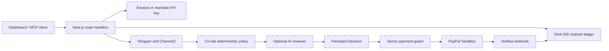
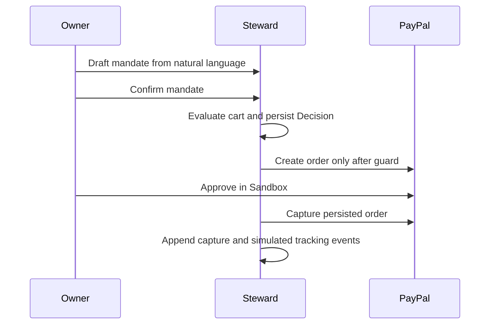

# Steward architecture

The model proposes structured data and explanations. The policy engine, persisted
decision, ownership checks, and payment guard decide whether money can move.
Product descriptions are untrusted input. PayPal credentials and amounts never
come from an LLM response or browser request.
