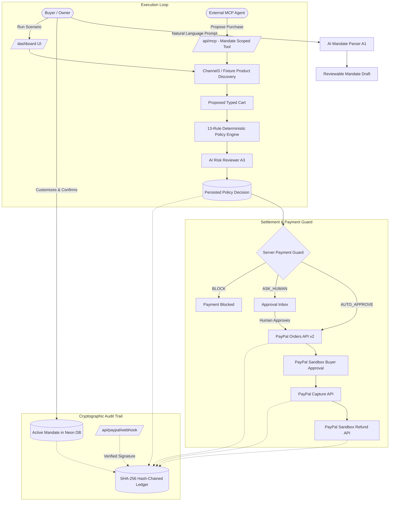
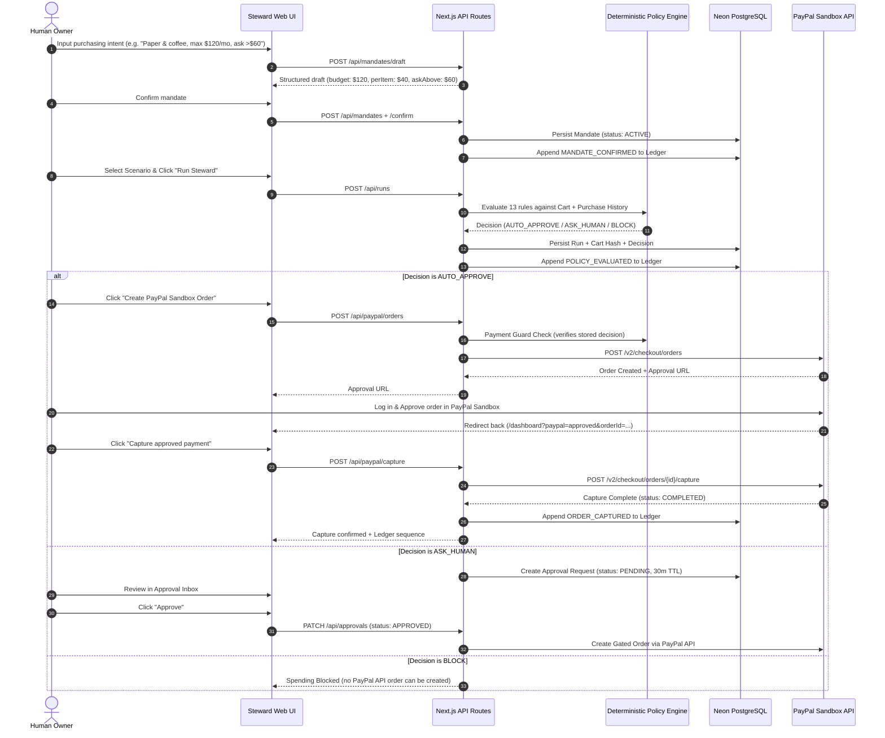

# Steward Architecture Specification

Steward is an autonomous procurement platform governed by explicit human mandates, a 13-rule deterministic policy engine, and a tamper-evident cryptographic audit ledger.

---

## 1. System Overview

---

## 2. Purchasing Lifecycle Sequence

---

## 3. Core Architectural Principles

### 1. Model Proposes, Deterministic Engine Decides
- The AI agents (Mandate Parser `A1`, Shopper Agent `A2`, Risk Reviewer `A3`, Dispute Advocate `A4`) generate structured proposals.
- **The AI cannot authorize spending or lower severity.** If the deterministic policy returns `BLOCK`, an AI reviewer saying "approve" is strictly ignored. The engine can only escalate severity (`AUTO` &rarr; `ASK_HUMAN`), never downgrade.

### 2. Server-Side Payment Guard
- PayPal orders are never created directly from client parameters.
- `/api/paypal/orders` verifies:
  1. Mandate exists and is in `ACTIVE` status (not revoked or expired).
  2. Stored `decision` is either `AUTO_APPROVE` or an unexpired `APPROVED` human review.
  3. The cart hash matches the exact items evaluated by the policy engine.
  4. The currency is strictly `USD`.

### 3. Cryptographic Audit Trail (SHA-256 Ledger)
Every event in the lifecycle is hashed into an immutable chain:
$$\text{entryHash}_n = \text{SHA-256}(\text{sequence} \mathbin{\Vert} \text{timestamp} \mathbin{\Vert} \text{prevHash} \mathbin{\Vert} \text{mandateId} \mathbin{\Vert} \text{type} \mathbin{\Vert} \text{canonicalJson}(\text{payload}))$$
Any modification to past entries breaks subsequent hashes, detectable by `/api/ledger/verify`.

---

## 4. API Routes Reference

| Route | Method | Auth / Protection | Purpose |
|---|---|---|---|
| `/api/health` | GET | Public | Service health & database connectivity check |
| `/api/demo` | POST | Rate limited (10/min) | Seeds test buyer, active mandate, sample runs |
| `/api/auth/logout` | POST | Session | Clears session cookie |
| `/api/mandates` | POST | Session / Rate limited | Creates a new mandate draft |
| `/api/mandates/draft` | POST | Rate limited | AI/fallback parsing of natural language instructions |
| `/api/mandates/:id` | GET | Session ownership | Fetches mandate details |
| `/api/mandates/:id/confirm` | POST | Session ownership | Activates a draft mandate |
| `/api/mandates/:id/revoke` | POST | Session ownership | Emergency kill switch: revokes active mandate |
| `/api/runs` | POST | Session ownership | Executes agent cart discovery & policy check |
| `/api/approvals` | GET, PATCH | Session ownership | Lists pending approvals; resolves approve/reject |
| `/api/paypal/health` | GET | Internal / Sandbox | Verifies PayPal Sandbox OAuth connectivity |
| `/api/paypal/orders` | POST | Session + Payment Guard | Creates gated order via PayPal Orders API v2 |
| `/api/paypal/capture` | POST | Session + Payment Guard | Captures approved order; logs to ledger |
| `/api/paypal/refund` | POST | Session ownership | Executes live refund against captured transaction |
| `/api/paypal/vault` | POST | Public (410) | Documents vault token availability status |
| `/api/paypal/webhook` | POST | PayPal signature verify | Receives real webhooks (capture, refund, dispute) |
| `/api/paypal/webhook/replay` | POST | Rate limited | Dev-only simulation of dispute webhook |
| `/api/disputes/advocate` | POST | Session ownership | Generates factual dispute defense using ledger |
| `/api/ledger/verify` | GET | Mandate scoped | Cryptographically verifies SHA-256 hash chain |
| `/api/ledger/export` | GET | Session ownership | Exports ledger in CSV or JSON with verification headers |
| `/api/mcp` | POST | Mandate API Key | External Model Context Protocol server (4 tools) |
| `/api/mcp/keys` | POST | Session ownership | Issues mandate-scoped API key |
| `/api/redteam` | POST | Rate limited | Evaluates adversarial attack fixtures |
